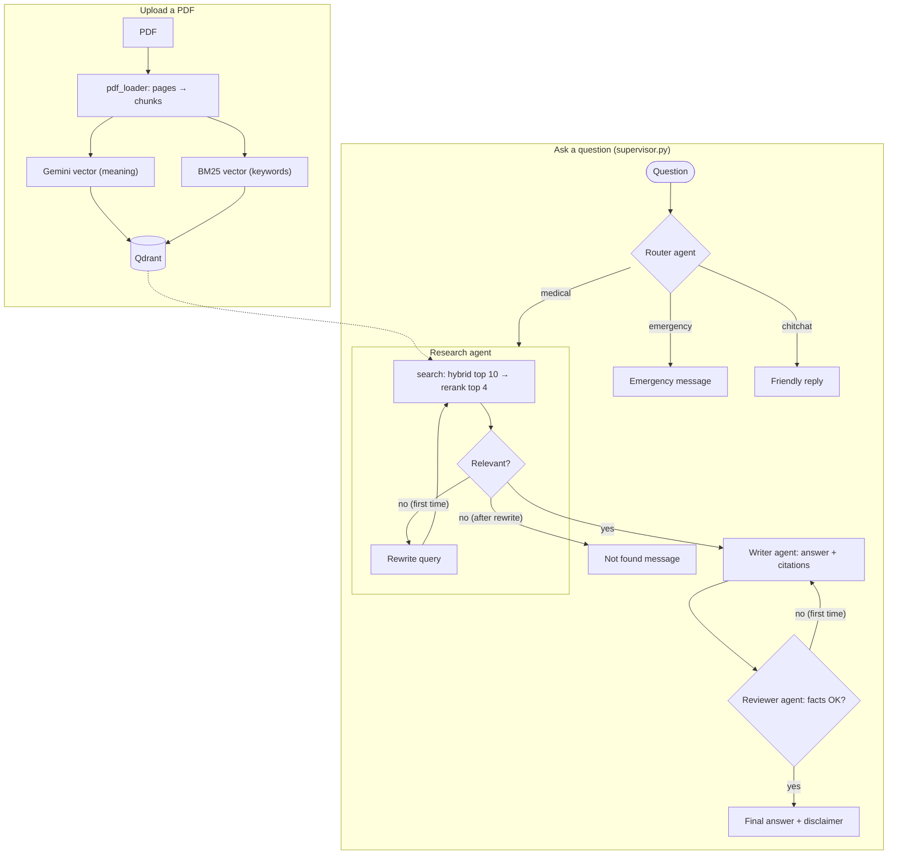

# 🩺 MediGuide AI – Agentic RAG for Clinical Knowledge

Upload medical PDFs and ask questions. A **team of 4 AI agents** (built with LangGraph) works on every question: a **Router** sorts the message, a **Researcher** finds the right chunks with hybrid search + reranking, a **Writer** answers with **citations and page numbers**, and a **Reviewer** fact-checks the answer before you see it. If the documents don't contain the answer, it says so instead of guessing.

**Tech:** Python · LangChain · LangGraph · Qdrant (hybrid search) · FlashRank · Gemini · FastAPI · HTML/JS · RAGAS

## Project structure
```
mediguide-ai/
├── code/
│   ├── config.py        settings + Gemini models (start reading here)
│   ├── pdf_loader.py    read a PDF, split it into chunks
│   ├── vector_db.py     store chunks in Qdrant (meaning + keyword vectors)
│   ├── search.py        hybrid search + reranking
│   ├── safety.py        emergency check + fixed messages (disclaimer, "not found"...)
│   ├── agents/          the team, one agent per file
│   │   ├── router_agent.py    emergency / small talk / medical?
│   │   ├── research_agent.py  search -> grade -> rewrite & retry (a subgraph)
│   │   ├── writer_agent.py    answer with [n] citations
│   │   └── reviewer_agent.py  fact-check; send back to writer once if wrong
│   ├── supervisor.py    connects the agents into one LangGraph workflow
│   ├── main.py          FastAPI app: serves the chat page + /upload and /ask
│   ├── evaluation.py    RAGAS quality scores
│   └── ui/              the chat page (opened in the browser)
│       ├── index.html   page layout
│       ├── style.css    colors and layout
│       └── script.js    sends PDFs/questions to the API, shows answers
├── data/                uploaded PDFs (created automatically)
├── requirements.txt
├── .env                 your Gemini key + settings (never commit this)
└── README.md
```
**Suggested reading order:** config → pdf_loader → vector_db → search → safety → agents/ (router → research → writer → reviewer) → supervisor → main → ui/ → evaluation

## How it works


## Setup (once)
```powershell
py -3.11 -m venv venv
venv\Scripts\activate
pip install -r requirements.txt
docker run -d -p 6333:6333 -v qdrant_data:/qdrant/storage --name qdrant qdrant/qdrant
```
Put your Gemini key in `.env` (`GOOGLE_API_KEY=...`). Get one at https://aistudio.google.com/apikey

## Run
From the `mediguide-ai` folder, with the venv activated:
```powershell
docker start qdrant                              # if it isn't running
uvicorn main:app --reload --app-dir code --port 8001   # then open http://127.0.0.1:8001
python code/evaluation.py                        # optional: RAGAS scores
```

> ⚠️ Educational project only. Not a substitute for professional medical advice.
